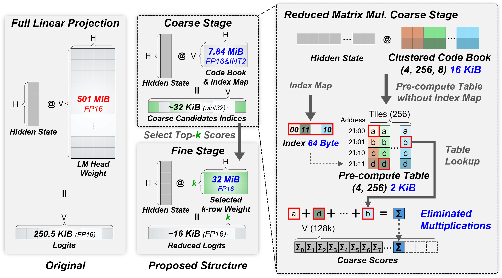

# CFHead

**Fast LM Head via Coarse-Fine Decomposition and Tile-Wise Weight Clustering**  
IEEE Transactions on Computers, Vol. 75, No. 11, 2026

[](https://ieeexplore.ieee.org/document/11658938)
[](https://doi.org/10.1109/TC.2026.3725429)

<p align="center">
  
</p>

## Overview

**CFHead** is a training-free LM Head acceleration method for large-vocabulary language models.

A conventional LM Head performs a full-precision projection from the hidden state to **every vocabulary token at every decoding step**. For large vocabularies, this repeatedly moves hundreds of MiB to several GiB of weights and can become a practical memory-bandwidth and latency bottleneck.

CFHead reformulates this operation as a **candidate-screening problem**:

1. **Coarse stage** — cheaply score the full vocabulary using tile-wise codebooks, compact index maps, LUT lookup, and reduction.
2. **Candidate selection** — keep only the most promising top-k tokens.
3. **Fine stage** — load the original LM Head weights only for those candidates and compute their logits exactly.

The coarse stage is approximate; the final candidate projection is not.

### Highlights

- **5.82× average LM Head-only speed-up** across a broad model sweep
- **Up to 12.7× LM Head acceleration** in the batch-size evaluation
- Only **-0.21%p average accuracy change** across 9 downstream benchmarks
- **7.84 MiB auxiliary representation** versus a 501 MiB FP16 LM Head in the LLaMA3.2-1B comparison setting
- **100% top-1 candidate hit ratio** for greedy decoding up to 16,384 steps in the long-form evaluation
- Evaluated across **LLaMA, Qwen, Mistral/Ministral, OPT, and BLOOM** model families
- Evaluated on **RTX 4090, DGX Spark, and A100** GPUs
- No retraining or model fine-tuning is required

---

## Why CFHead?

CFHead is designed for cases where the output projection itself is expensive, especially **large-vocabulary autoregressive decoding at small batch sizes**.

Compared with static vocabulary pruning, CFHead still screens the **entire vocabulary** at every step. Compared with cluster-level retrieval, it computes a separate coarse score for every token and controls the fine-stage candidate count directly. This helps retain long-tail candidates while reducing full-precision LM Head traffic.

The implementation is also hardware-friendly: after a small activation-dependent LUT is generated, most coarse-stage work consists of **index streaming, LUT lookup, and reduction summation** rather than a full-vocabulary FP16/BF16 GEMV.

---

## How It Works

### Offline preprocessing

The LM Head weight matrix `W ∈ R[V × H]` is split along the hidden dimension into tiles. For each tile, vocabulary-row vectors are clustered independently with k-means.

CFHead stores:

- a small tile-wise **codebook** of centroid vectors, and
- a compact **index map** identifying the centroid assigned to each vocabulary row in each tile.

For the LLaMA3.2-1B example in the paper with `tile_size=8` and `cluster_size=4`:

- Original FP16 LM Head: **~501 MiB**
- Codebook: **~16 KiB**
- INT2 index map: **~7.82 MiB**
- Coarse representation: **~7.84 MiB**

### Online decoding

```text
hidden state h
     │
     ├─ split into hidden-dimension tiles
     │
     ├─ dot products with the small codebook
     │        ↓
     │   activation-dependent LUT
     │        ↓
     ├─ index streaming + LUT lookup + reduction
     │        ↓
     │   coarse score for every vocabulary token
     │        ↓
     ├─ top-k candidate selection
     │        ↓
     └─ exact FP16/BF16 projection using original weights
              only for selected candidates
```

In compact form:

```text
W_lm : [V, H]

Offline:
  tile W_lm along H
  → k-means per tile
  → codebook [N_tile, C, T]
  → index map [V, N_tile]

Online:
  h → tiled h
    → LUT[t,c] = <h_tile[t], codebook[t,c]>
    → coarse[v] = Σ_t LUT[t, index_map[v,t]]
    → top-k(coarse)
    → exact logits with W_lm[top-k]
    → token selection
```

---

## Results

### 1. Overall Accuracy–Memory–Latency Trade-off

| Method | Avg. Accuracy Δ | Auxiliary Memory | Memory for Logit Computation | TPOT Speed-up |
|---|---:|---:|---:|---:|
| Original | Baseline | – | 501 MiB | 1.00× |
| VocabTrim* | -6.34%p | – | 32.0 MiB | **1.47×** |
| FlashHead | -10.3%p | 31.8 MiB | 63.8 MiB | 1.16× |
| **CFHead** | **-0.21%p** | **7.84 MiB** | **39.8 MiB** | **1.18×** |

CFHead provides a favorable balance between **quality preservation, memory footprint, and decoding latency**. VocabTrim attains higher TPOT speed-up in this setting, but with a substantially larger average quality drop. CFHead retains nearly all downstream quality while using much less auxiliary memory than FlashHead.

\* In the paper comparison, VocabTrim is used as a static vocabulary-pruning baseline applied directly to final generation without target-model verification.

### 2. Quality Across Diverse Benchmarks

| Method | MMLU | ARC | HellaSwag | GSM8K | IFEval | PIQA | WinoGrande |
|---|---:|---:|---:|---:|---:|---:|---:|
| Original | 39.8 | 46.9 | 37.5 | 40.6 | 48.9 | 57.8 | 51.6 |
| **CFHead** | **39.8** | **46.9** | **39.1** | **40.6** | **49.4** | **58.6** | **51.6** |

**CFHead matches or outperforms the original LM Head on 7 of the 9 evaluated downstream benchmarks.** Across all nine benchmarks, the average accuracy change is only **-0.21%p**.

*ARC denotes ARC-Challenge.*

Additional robustness results reported in the paper:

- **100% top-1 candidate hit ratio** on ShareGPT, LMSYS-Chat-1M, and LongBench for greedy decoding up to **16,384 decoding steps** on LLaMA3.2-1B and LLaMA3.1-8B.
- Under nucleus sampling, high token-level agreement is maintained across lightweight and middle-scale LLaMA/Qwen models.
- On **HumanEval+**, pass@1 and pass@10 match the original LM Head for all evaluated models; pass@5 differs only by **+0.2%p** for Qwen3.5-0.8B and is otherwise unchanged.

### 3. LM Head Speed-up Across Model Families

Representative LM Head-only speed-ups from the paper's DGX Spark model sweep (`tile_size=8`, `cluster_size=64`, `top-k=256`):

| Family | Representative Model | LM Head Speed-up |
|---|---|---:|
| LLaMA | LLaMA3.2-1B | **8.56×** |
| LLaMA | LLaMA3.1-8B | **4.81×** |
| Qwen | Qwen2.5-32B | **10.7×** |
| Mistral | Mistral-Small-3.1-24B | **5.23×** |
| OPT | OPT-13B | **7.37×** |
| BLOOM | BLOOM-560M | **7.37×** |

Across the full model sweep, CFHead achieves **5.82× average LM Head-only acceleration**. In the separate batch-size study, the maximum observed speed-up is **12.7×** for Qwen3.5-9B at batch size 1, and acceleration remains above 1× for all evaluated models even at batch size 32.

End-to-end gains depend on how much of the total decoding time is attributable to the LM Head. The paper reports **up to 1.18× TPOT speed-up on DGX Spark**, while bandwidth-rich platforms such as A100 show smaller end-to-end gains because Transformer blocks, KV-cache traffic, memory hierarchy, and kernel overhead increasingly dominate total latency.

---

## Evaluated Models and Hardware

The paper evaluates CFHead across multiple model families and system environments, including:

**Model families**

- LLaMA 3.x
- Qwen 2.5 / Qwen 3.5
- Mistral / Ministral
- OPT
- BLOOM

**GPUs**

- NVIDIA RTX 4090
- NVIDIA DGX Spark
- NVIDIA A100

The repository itself provides a reference implementation and evaluation harness centered on Hugging Face causal language models with a standard output embedding / LM Head interface.

---

## Repository Contents

```text
.
├── algorithm/
│   ├── CFHead.py       # Proposed coarse-fine LM Head
│   ├── FlashHead.py    # Retrieval-based baseline
│   ├── VocabTrim.py    # Static vocabulary-pruning baseline
│   └── Original.py     # Original full-precision LM Head
├── kernel/             # CUDA / Triton kernels for CFHead
├── script/
│   ├── eval_common.py  # Shared evaluation runner
│   ├── arc_challenge.py
│   ├── hellaswag.py
│   ├── gsm8k.py
│   └── ifeval.py
├── sh/                 # Convenience launch scripts
├── data/               # Benchmark data
├── result/             # Evaluation outputs and leaderboard
└── README.md
```

Available repository benchmark runners currently include:

- ARC-Challenge
- HellaSwag
- GSM8K
- IFEval

---

## Requirements

```text
Python >= 3.10
PyTorch >= 2.1 with CUDA
transformers
```

Optional for accelerated kernels:

```text
triton
ninja
```

Install the Python dependencies:

```bash
pip install torch transformers

# Optional
pip install triton ninja
```

---

## Quick Start

Run all implemented LM Head methods on ARC-Challenge:

```bash
bash sh/arc_challenge.sh --path /path/to/Llama-3.2-1B-Instruct
```

Run only CFHead and the original LM Head:

```bash
bash sh/arc_challenge.sh \
  --path /path/to/Llama-3.2-1B-Instruct \
  --algorithms CFHead,Original
```

Run only the original baseline:

```bash
bash sh/arc_challenge.sh \
  --path /path/to/Llama-3.2-1B-Instruct \
  --origin_only
```

Results are written to `result/`, and the generated leaderboard is available at `result/leaderboard.html`.

---

## CFHead Configuration

The repository defaults correspond to the paper's **baseline-comparison operating point**:

| Environment Variable | Default | Description |
|---|---:|---|
| `CFHEAD_TILE_SIZE` | 8 | Hidden-dimension tile size `T` |
| `CFHEAD_CLUSTER_SIZE` | 4 | Number of centroids per tile `C` |
| `CFHEAD_TOP_K` | 8192 | Fine-stage candidate count |
| `CFHEAD_KMEANS_ITERS` | 10 | Number of k-means iterations |
| `CFHEAD_SEED` | 99 | Clustering seed |

Example:

```bash
CFHEAD_TILE_SIZE=8 \
CFHEAD_CLUSTER_SIZE=64 \
CFHEAD_TOP_K=256 \
bash sh/arc_challenge.sh --path /path/to/model
```

The paper intentionally uses different operating points for different evaluation goals. For example, runtime-oriented experiments use a larger cluster size and smaller top-k than the baseline-comparison setting. See the paper for the full accuracy–speed–storage trade-off study.

---

## Citation

If CFHead is useful in your research, please cite:

```bibtex
@ARTICLE{11658938,
  author={Kim, Jung-Woo and Yoon, Seung-Hwan and Lee, Hye-Rin and Lee, Hak-Bum and Oh, Su-Min and Kang, Seung-Yoon and Seo, Young-Ho},
  journal={IEEE Transactions on Computers}, 
  title={Fast LM Head via Coarse-Fine Decomposition and Tile-Wise Weight Clustering}, 
  year={2026},
  volume={75},
  number={11},
  pages={3927-3940},
  keywords={Decoding;Head;Modeling;Tiles;Vocabulary;Indexes;Indexing;Accuracy;Vectors;Costing;LLM;acceleration;LM head;logits;GPU;bandwidth},
  doi={10.1109/TC.2026.3725429}}
```

---

## License

This repository is released for research purposes.

Model weights remain subject to the licenses of their respective model providers.